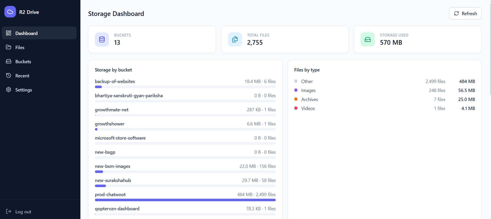
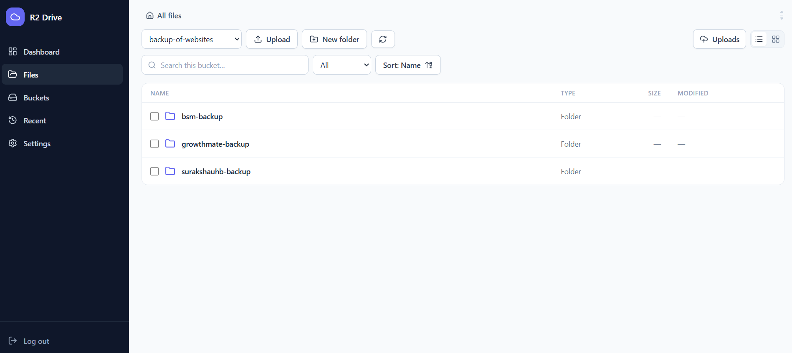

# r2-drive

### A self-hosted, single-admin file manager for Cloudflare R2 storage

_Maintained & extended by **Saurabh Diwate** — Full-Stack Troubleshooting, Integration & Deployment Engineer_

**r2-drive** turns your personal Cloudflare R2 buckets into a clean, Google
Drive–style web app you run on your own server — no third-party SaaS, no vendor
lock-in, no recurring fees. Sign in, browse buckets, drag-and-drop files (with
resumable multipart uploads), preview documents, and manage everything with
powerful operations like move, copy, rename, search, and share.


---

## Screenshots

> The interface running against live Cloudflare R2 buckets — no mock data.

<p align="center">
  
  
</p>
<p align="center">
  <em>Storage dashboard (left) and the file explorer (right)</em>
</p>

---

## Author

**Hi, I'm Saurabh Diwate 👋**

**Full-Stack Troubleshooting, Integration & Deployment Engineer**

I help founders, agencies, and growing businesses fix difficult website
problems, complete unfinished features, integrate third-party services, and
deploy applications reliably.

My work focuses on practical outcomes: finding the root cause, implementing a
maintainable solution, and making sure the application works correctly in
production.

**r2-drive** is one of my projects — designed, built, and deployed end-to-end:
from authentication and the upload engine to Docker packaging and production
deployment guides.

---

## Why r2-drive?

Cloudflare R2 offers **unbeatable value** — zero egress fees, far cheaper
storage than S3, and no per-request costs on reads. But R2 ships as raw API
endpoints, not a file manager. You get a raw bucket URL, a spreadsheet of keys,
and nothing to click.

**r2-drive is the missing layer**: a production-grade, ready-to-deploy web app
that turns your R2 account into a private cloud drive. One container, one admin
account, full control of your data.

### Highlights

- **Private by default** — single-admin login with bcrypt password hashing,
  HMAC-signed HttpOnly session cookies, CSRF protection, and per-IP login
  rate limiting. No signups, no orgs, no telemetry.
- **Resumable uploads** — small files use presigned PUTs; large files stream
  through resumable multipart uploads (8 MiB parts, concurrent, 3 parts / 2
  files in flight) that survive page reloads via IndexedDB.
- **A complete file manager** — list/grid views, folder navigation,
  breadcrumbs, live search, recent files, and drag-and-drop anywhere.
- **Powerful file operations** — preview (images, PDF, audio/video, and
  sanitized Markdown), download, rename, move, copy, create folders, and
  permanent delete.
- **One-click sharing** — generate short-lived download links for any file.
- **Storage dashboard** — per-bucket usage and object counts at a glance.
- **Deploy anywhere** — multi-stage `Dockerfile` running as a non-root user,
  ready `docker-compose.yml`, and an EasyPanel step-by-step guide.
- **Server-side secrets only** — credentials never reach the browser bundle.

---

## Tech stack

| Layer        | Choice                                                                 |
| ------------ | ---------------------------------------------------------------------- |
| Framework    | [Next.js 14](https://nextjs.org) (App Router, Server Actions & Route Handlers) |
| Language     | [TypeScript 5](https://www.typescriptlang.org) (strict)                |
| Storage      | [Cloudflare R2](https://developers.cloudflare.com/r2/) (S3-compatible API) |
| SDK          | AWS SDK for JavaScript (`@aws-sdk/client-s3`, `s3-request-presigner`)  |
| Auth         | bcrypt (cost 12) + HMAC-SHA256 sessions, custom CSRF + rate limiting   |
| UI           | React 18, [Tailwind CSS](https://tailwindcss.com), [lucide-react](https://lucide.dev) icons |
| Rendering    | DOMPurify-sanitized Markdown, Prism.js syntax highlighting, streaming object previews |
| Deployment   | Docker (multi-stage, non-root), Docker Compose, EasyPanel             |
| Tooling      | ESLint, Prettier, `tsc --noEmit`, Next.js production build            |

---

## Table of contents

- [Author](#author)
- [Features](#features)
- [How it works](#how-it-works)
- [Getting started](#getting-started)
  - [1. Cloudflare R2 setup](#1-cloudflare-r2-setup)
  - [2. Generate secrets](#2-generate-secrets)
  - [3. Configure the environment](#3-configure-the-environment)
  - [4. Run locally](#4-run-locally)
- [Environment variables](#environment-variables)
- [Deployment](#deployment)
  - [Docker Compose](#docker-compose)
  - [EasyPanel](#easypanel)
- [API reference](#api-reference)
- [Project structure](#project-structure)
- [Security](#security)
- [Development](#development)
- [Troubleshooting](#troubleshooting)
- [Roadmap ideas](#roadmap-ideas)
- [License & attribution](#license--attribution)

---

## Features

### Authentication & security
- Single admin account (`APP_USERNAME` + bcrypt-hashed `APP_PASSWORD_HASH`).
- HMAC-SHA256 signed session cookie (`HttpOnly`, `SameSite=lax`, `Secure` in
  production, 7-day expiry configurable via `SESSION_DURATION_HOURS`).
- CSRF protection (Origin/Host validation) on every state-changing API route.
- In-memory rate limiting on login attempts (per IP + username).
- All secrets live in server environment variables — never in client code.

### File management
- Browse all accessible buckets; switch buckets from the toolbar.
- Folder navigation with breadcrumbs and deep-linkable state (`?bucket=&prefix=`).
- List and grid views with file-type icons, sizes, and modified dates.
- Live, debounced search within the current bucket.
- Recent files page across the selected bucket.
- Create folders, rename, move, copy, and delete files/folders.
- Downloads use presigned attachment URLs; previews stream inline content.
- Short-lived share links with configurable expiration.

### Uploads
- Drag-and-drop and file-picker uploads with progress bars and queue management.
- Files < 8 MiB: single-shot presigned PUT with XHR progress.
- Files >= 8 MiB: R2 **multipart upload** (8 MiB parts, up to 3 concurrent
  parts, up to 2 files in parallel).
- Upload state persisted in IndexedDB — reload the page and uploads resume.
- Retry / pause / cancel per item; failed items show actionable errors.

### Preview
- Images (thumbnail grid + lightbox), PDFs, audio, and video.
- Text and Markdown streamed from R2 and rendered sanitized (DOMPurify) with
  Prism.js syntax highlighting.
- Large text previews truncated to a safe byte budget.

### Observability
- Settings page shows R2 configuration status, endpoint, connection validity,
  and accessible-bucket count with a live **Test connection** button.
- `/api/health` liveness endpoint wired into the Docker healthcheck.

---

## How it works

```
┌─────────────── Browser ───────────────┐      ┌─────────────── Server ───────────────┐
│                                       │      │                                     │
│  Login  ─────────────────────────────►│      │  bcrypt verify → session cookie     │
│                                       │      │                                     │
│  Browse buckets / folders / search ──►│      │  ListBucket, ListObjectsV2 (SSE)    │
│                                       │      │                                     │
│  Upload (small)  ────────────────────►│      │  presigned PUT URL  ───────────────►│
│  PUT straight to R2  ◄────────────────│      │                                     │
│                                       │      │  R2 Multipart: create / part URLs / │
│  Upload (large)  ────────────────────►│      │  complete / abort (client streams)  │
│                                       │      │                                     │
│  Preview / download ─────────────────►│      │  presigned GET or streaming proxy   │
│                                       │      │                                     │
│  Move / copy / rename / delete ──────►│      │  CopyObject, DeleteObject, head     │
│                                       │      │                                     │
└───────────────────────────────────────┘      └──────────────▲───┬──────────────────┘
                                                              │   │  S3-compatible API
                                                       ┌──────┴───▼──────┐
                                                       │  Cloudflare R2  │
                                                       │  (your buckets)  │
                                                       └─────────────────┘
```

Uploads and downloads go **directly between the browser and R2** via
short-lived presigned URLs, so your server never handles large file payloads —
it only orchestrates. That keeps memory and bandwidth usage minimal even for
multi-gigabyte files.

---

## Getting started

### Prerequisites

- Node.js 18.17+ (20 recommended) and npm.
- A Cloudflare account with at least one R2 bucket.
- (Optional) Docker for containerized deployment.

### 1. Cloudflare R2 setup

1. Create a bucket: Cloudflare dashboard → **R2** → **Create bucket**.
2. Create an API token: R2 → **Manage R2 API Tokens** → **Create API token**
   with **Object Read & Write** permission (permits list/read/write/delete but
   not account admin).
3. Note your **Account ID** (dashboard → overview → right sidebar) or use it to
   derive the endpoint: `https://<ACCOUNT_ID>.r2.cloudflarestorage.com`.

### 2. Generate secrets

```bash
npm install

# Random 64-character session secret → SESSION_SECRET
npm run gen:secret

# Bcrypt hash of your login password → APP_PASSWORD_HASH
npm run hash:password -- -- "your-strong-password"
```

`scripts/hash-password.mjs` prints two forms: the raw hash (for real
environment variables) and the `.env`-escaped form (see the note below).

### 3. Configure the environment

Copy `.env.example` to `.env.local` and fill it in:

```bash
APP_USERNAME=admin
APP_PASSWORD_HASH='...'
SESSION_SECRET='...'
CLOUDFLARE_ACCOUNT_ID=...
R2_ACCESS_KEY_ID=...
R2_SECRET_ACCESS_KEY=...
```

> **Why the `\$` escaping?** Next.js expands `$…` sequences in `.env` files even
> inside quotes, which corrupts bcrypt hashes (`$2b$12$…`). So when a hash lives
> in a local `.env` file, every `$` must be written as `\$`. Real environment
> variables (Docker, EasyPanel, `export`, systemd) are not parsed this way —
> paste the raw hash there. The helper script prints both forms so you can't get
> it wrong.

### 4. Run locally

```bash
npm run dev
```

Open http://localhost:3000 and log in.

Production-mode smoke test:

```bash
npm run build
npm start            # add COOKIE_SECURE=false for plain-HTTP local testing
```

---

## Environment variables

All values are **server-side only** — never prefix secrets with `NEXT_PUBLIC_`.

| Variable                  | Required | Description                                                        |
| ------------------------- | :------: | ------------------------------------------------------------------ |
| `APP_USERNAME`            |   yes    | Login username.                                                    |
| `APP_PASSWORD_HASH`       |   yes    | Bcrypt hash of the login password (`scripts/hash-password.mjs`).   |
| `SESSION_SECRET`          |   yes    | Signs session cookies (`scripts/generate-secret.mjs`).             |
| `CLOUDFLARE_ACCOUNT_ID`   |  yes*    | Cloudflare account ID.                                             |
| `R2_ACCESS_KEY_ID`        |  yes*    | R2 API token access key.                                           |
| `R2_SECRET_ACCESS_KEY`    |  yes*    | R2 API token secret key.                                           |
| `R2_ENDPOINT`             |    no    | Custom endpoint (default: `https://<ACCOUNT_ID>.r2.cloudflarestorage.com`). |
| `SESSION_DURATION_HOURS`  |    no    | Session lifetime in hours (default: 168 = 7 days).                        |
| `COOKIE_SECURE`           |    no    | Set `false` **only** when serving plain HTTP (not recommended).           |

\* Required for R2 access. Buckets are discovered at runtime, so no bucket name
is configured.

---

## Deployment

### Docker Compose

```bash
# 1. Create a .env with the variables above (raw values, no quotes)
# 2. Build and start:
docker compose up -d --build
```

The `docker-compose.yml`:
- Fails fast if required secrets are missing (`${VAR:?message}`).
- Runs as the non-root `nextjs` user.
- Exposes port 3000 with a `/api/health` healthcheck and `restart: unless-stopped`.

### EasyPanel

Full step-by-step VPS deployment is in
[`docs/easypanel-deployment.md`](docs/easypanel-deployment.md) — create a
project from source, set the environment variables, enable HTTPS, deploy, and
you're live.

### Any platform with Docker / systemd

The image is a standard Node production build (`next start`). Point any
container platform at the `Dockerfile`, inject the environment variables, and
expose port 3000 behind your favorite reverse proxy (Caddy, nginx, Traefik).
HTTPS is strongly recommended (Secure cookies).

---

## API reference

All routes require an authenticated session except `/api/health`.

| Route                              | Method | Description                                  |
| ---------------------------------- | :----: | -------------------------------------------- |
| `/api/auth/login`                  | POST   | Log in, set session cookie                   |
| `/api/auth/logout`                 | POST   | Destroy session                              |
| `/api/auth/me`                     | GET    | Current session user + expiry                |
| `/api/health`                      | GET    | Liveness probe (no auth)                     |
| `/api/r2/status`                   | GET    | Config + connection status                   |
| `/api/r2/test`                     | POST   | Test R2 connection                           |
| `/api/buckets`                     | GET    | List accessible buckets                      |
| `/api/objects`                     | GET    | List folder contents                         |
| `/api/objects/head`                | GET    | Object metadata                              |
| `/api/objects/folder`              | POST   | Create folder                                |
| `/api/objects/rename`              | POST   | Rename object                                |
| `/api/objects/move`                | POST   | Move object(s)                               |
| `/api/objects/copy`                | POST   | Copy object(s)                               |
| `/api/objects/delete`              | POST   | Delete object(s)                             |
| `/api/download`                    | GET    | Redirect to presigned attachment download         |
| `/api/preview`                     | GET    | Stream inline preview content                |
| `/api/share`                       | GET    | Create short-lived share link                |
| `/api/upload/presign`              | POST   | Presigned PUT URL for small uploads          |
| `/api/multipart/create`            | POST   | Start multipart upload                       |
| `/api/multipart/part-url`          | POST   | Presigned upload URL for a part              |
| `/api/multipart/complete`          | POST   | Assemble multipart upload                    |
| `/api/multipart/abort`             | POST   | Abort multipart upload                       |
| `/api/recent`                      | GET    | Recently modified objects                    |
| `/api/search`                      | GET    | Search a bucket by prefix pattern            |
| `/api/storage`                     | GET    | Storage summary per bucket                   |

---

## Project structure

```
r2-drive/
├─ src/
│  ├─ app/
│  │  ├─ api/                  # 24 route handlers (auth, r2, objects, upload, …)
│  │  ├─ (app)/                # authenticated pages: dashboard, files, buckets, recent, settings
│  │  ├─ login/                # login page
│  │  ├─ layout.tsx            # root layout
│  │  └─ globals.css
│  ├─ components/
│  │  ├─ app-shell/            # sidebar navigation, header
│  │  ├─ files/                # file explorer, toolbar, list/grid, dropzone
│  │  ├─ preview/              # preview modal (image/pdf/audio/video/markdown)
│  │  ├─ share/                # share-link modal
│  │  ├─ storage/              # storage dashboard + header
│  │  ├─ upload/               # upload queue UI
│  │  ├─ dialogs/              # move/copy dialog
│  │  └─ ui/                   # button, badge, modal, toast, menu, breadcrumbs, …
│  └─ lib/
│     ├─ auth/                 # password, session, rate-limit, guard
│     ├─ r2/                   # config, client, buckets, objects, ops, multipart, presign, stats
│     ├─ upload/               # uploader engine + IndexedDB persistence
│     └─ api-route, api, csrf, types, utils
├─ scripts/
│  ├─ hash-password.mjs        # bcrypt hash generator
│  └─ generate-secret.mjs      # session secret generator
├─ docs/
│  └─ easypanel-deployment.md  # EasyPanel deployment guide
├─ Dockerfile                  # multi-stage, non-root
├─ docker-compose.yml
├─ .env.example
└─ LICENSE                     # MIT
```

---

## Security

- **Passwords** verified with bcrypt (cost 12); only the hash is ever stored.
- **Sessions** are HMAC-SHA256 signed cookies (`HttpOnly`, `SameSite=lax`,
  `Secure` in production) with a 7-day expiry, keyed by `SESSION_SECRET`.
- **CSRF** — every state-changing route validates the `Origin`/`Host` header.
- **Rate limiting** — in-memory throttling of failed logins per IP + username.
- **Safe previews** — Markdown is sanitized with DOMPurify before rendering.
- **Path safety** — object keys are validated (`assertSafeKey`) to prevent
  traversal through the API.
- **Minimal surface** — credentials are injected at runtime via environment
  variables; the client bundle contains no secrets.
- **Least privilege R2 token** — use a token scoped to **Object Read & Write**
  only.

---

## Development

```bash
npm run dev            # development server (http://localhost:3000)
npm run build          # production build
npm start              # run the production build
npm run lint           # ESLint
npm run typecheck      # tsc --noEmit
npm run hash:password  # generate APP_PASSWORD_HASH
npm run gen:secret     # generate SESSION_SECRET
```

---

## Troubleshooting

| Symptom | Likely cause / fix |
| ------- | ------------------ |
| "Invalid username or password" on login | Wrong `APP_PASSWORD_HASH` or password; regenerate with `scripts/hash-password.mjs`. |
| Login succeeds but browser bounces back to `/login` | Secure cookie dropped over plain HTTP — enable HTTPS, or set `COOKIE_SECURE=false` for a non-TLS setup. |
| Settings shows missing `CLOUDFLARE_ACCOUNT_ID` | Var not set, or `R2_ACCOUNT_ID` used — the app reads `CLOUDFLARE_ACCOUNT_ID`. |
| R2 connection invalid | Token lacks Object Read & Write, wrong account ID/endpoint. Use the **Test connection** button for details. |
| Large upload fails mid-way | Network interruption; multipart uploads resume from IndexedDB on reload. Check R2 part limits. |

---

## Roadmap ideas

- Public share-page with watermark-free viewing and password protection.
- Trash / soft-delete with retention window.
- Client-side folder downloads (zip) and multi-file selection in grid view.
- Optional read-only second user or granular share permissions.
- Object lifecycle policies surfaced in the dashboard.
- e2e test suite (Playwright) and CI workflow.

---

## License & attribution

MIT License.

**r2-drive** is authored and maintained by **Saurabh Diwate** and ships with
its own Docker setup, docs, and test infrastructure.
