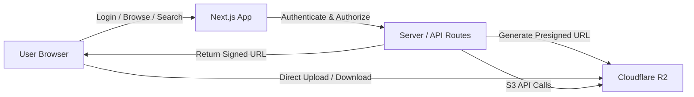

# R2 Drive

> Self-hosted Google Drive-style file manager for Cloudflare R2, built with Next.js and TypeScript.

[](https://github.com/saurabhdiwate/r2-drive/actions/workflows/ci.yml)


---

## Screenshots

<p align="center">
  
  
</p>
<p align="center">
  <em>Storage dashboard (left) and the file explorer (right)</em>
</p>

---

## Key Features

- **Private by default** — single-admin login with bcrypt hashing, HMAC-signed sessions, CSRF protection, and rate limiting
- **Resumable uploads** — small files use presigned PUTs; large files use multipart uploads (8 MiB parts) with IndexedDB persistence
- **Direct-to-R2 transfers** — browser uploads/downloads go straight to R2 via presigned URLs; server never handles file bytes
- **Complete file manager** — list/grid views, folder navigation, breadcrumbs, search, drag-and-drop
- **Powerful operations** — preview (images, PDF, audio/video, Markdown), download, rename, move, copy, create folders, delete
- **One-click sharing** — generate short-lived download links for any file
- **Storage dashboard** — per-bucket usage and object counts at a glance
- **Deploy anywhere** — multi-stage Docker, Docker Compose, EasyPanel, or any container platform

---

## Architecture



The server handles authentication, authorization, validation, and signed URL generation. The browser transfers file bytes directly to/from R2, keeping memory and bandwidth minimal even for multi-gigabyte files.

For detailed architecture documentation, see [`docs/architecture.md`](docs/architecture.md).

---

## Tech Stack

| Layer | Choice |
|-------|--------|
| Framework | [Next.js 14](https://nextjs.org) (App Router, Route Handlers) |
| Language | [TypeScript 5](https://www.typescriptlang.org) (strict) |
| Storage | [Cloudflare R2](https://developers.cloudflare.com/r2/) (S3-compatible API) |
| SDK | AWS SDK for JavaScript (`@aws-sdk/client-s3`, `s3-request-presigner`) |
| Auth | bcrypt (cost 12) + HMAC-SHA256 sessions, CSRF + rate limiting |
| UI | React 18, [Tailwind CSS](https://tailwindcss.com), [lucide-react](https://lucide.dev) |
| Testing | [Vitest](https://vitest.dev) (unit), [Playwright](https://playwright.dev) (E2E) |
| CI/CD | GitHub Actions (typecheck, lint, test, build, Docker) |
| Deployment | Docker (multi-stage, non-root), Docker Compose, EasyPanel |
| Security | CodeQL scanning, Dependabot dependency updates |

---

## Quick Start

### Prerequisites

- Node.js 18.17+ (20 recommended) and npm
- A Cloudflare account with at least one R2 bucket
- (Optional) Docker for containerized deployment

### 1. Clone and install

```bash
git clone https://github.com/saurabhdiwate/r2-drive.git
cd r2-drive
npm install
```

### 2. Generate secrets

```bash
# Random 64-character session secret
npm run gen:secret

# Bcrypt hash of your login password
npm run hash:password -- -- "your-strong-password"
```

### 3. Configure the environment

Copy `.env.example` to `.env.local` and fill in:

```bash
APP_USERNAME=admin
APP_PASSWORD_HASH='...'
SESSION_SECRET='...'
CLOUDFLARE_ACCOUNT_ID=...
R2_ACCESS_KEY_ID=...
R2_SECRET_ACCESS_KEY=...
```

### 4. Run locally

```bash
npm run dev
```

Open http://localhost:3000 and log in.

---

## Testing

```bash
npm run test            # Run all unit/integration tests
npm run test:watch       # Watch mode
npm run test:coverage    # With coverage report
npm run test:e2e         # Run Playwright E2E tests
npm run test:e2e:ui      # Playwright UI mode
npm run check            # Typecheck + lint + unit tests
```

### Unit Tests (Vitest)

157 tests across 12 test files covering:

- **Path handling** — basename, parentKey, joinKey, assertSafeName, assertSafeKey
- **File classification** — extension detection, file type categorization
- **R2 configuration** — env var reading, endpoint generation, missing vars detection
- **Presigned URLs** — upload, download, and share URL generation
- **Multipart uploads** — create, part URL, complete, abort
- **File operations** — delete, copy, move, rename, create folder
- **Authentication** — session creation/verification, password hashing, rate limiting
- **CSRF protection** — origin validation, cross-site rejection
- **Error handling** — API error responses, safe error messages

### E2E Tests (Playwright)

Tests for critical user flows:

- Health check endpoint
- Login page loads and shows form
- Unauthenticated access redirects to login
- Protected routes require authentication
- API endpoints return 401 for unauthenticated requests

---

## Deployment

### Docker Compose

```bash
# 1. Create a .env with the required variables
# 2. Build and start:
docker compose up -d --build
```

The `docker-compose.yml`:
- Fails fast if required secrets are missing
- Runs as the non-root `nextjs` user
- Exposes port 3000 with healthcheck and `restart: unless-stopped`

### EasyPanel

Full step-by-step VPS deployment guide: [`docs/easypanel-deployment.md`](docs/easypanel-deployment.md)

### Any Platform with Docker

```bash
docker build -t r2-drive .
docker run -p 3000:3000 --env-file .env r2-drive
```

Point any container platform at the `Dockerfile`, inject environment variables, and expose port 3000 behind a reverse proxy (Caddy, nginx, Traefik). HTTPS is strongly recommended.

---

## Configuration

### Environment Variables

All values are **server-side only** — never prefix secrets with `NEXT_PUBLIC_`.

| Variable | Required | Description |
|----------|:--------:|-------------|
| `APP_USERNAME` | yes | Login username |
| `APP_PASSWORD_HASH` | yes | Bcrypt hash of the login password |
| `SESSION_SECRET` | yes | Signs session cookies (64+ chars) |
| `CLOUDFLARE_ACCOUNT_ID` | yes* | Cloudflare account ID |
| `R2_ACCESS_KEY_ID` | yes* | R2 API token access key |
| `R2_SECRET_ACCESS_KEY` | yes* | R2 API token secret key |
| `R2_ENDPOINT` | no | Custom endpoint (default: `https://<ACCOUNT_ID>.r2.cloudflarestorage.com`) |
| `SESSION_DURATION_HOURS` | no | Session lifetime (default: 168 = 7 days) |
| `COOKIE_SECURE` | no | Set `false` only for plain HTTP (not recommended) |

*Required for R2 access. Buckets are discovered at runtime.

### API Reference

All routes require an authenticated session except `/api/health`.

| Route | Method | Description |
|-------|:------:|-------------|
| `/api/auth/login` | POST | Log in, set session cookie |
| `/api/auth/logout` | POST | Destroy session |
| `/api/auth/me` | GET | Current session user + expiry |
| `/api/health` | GET | Liveness probe (no auth) |
| `/api/buckets` | GET | List accessible buckets |
| `/api/objects` | GET | List folder contents |
| `/api/objects/head` | GET | Object metadata |
| `/api/objects/folder` | POST | Create folder |
| `/api/objects/rename` | POST | Rename object |
| `/api/objects/move` | POST | Move object(s) |
| `/api/objects/copy` | POST | Copy object(s) |
| `/api/objects/delete` | POST | Delete object(s) |
| `/api/download` | GET | Presigned attachment download |
| `/api/preview` | GET | Stream inline preview |
| `/api/share` | GET | Create share link |
| `/api/upload/presign` | POST | Presigned PUT URL |
| `/api/multipart/create` | POST | Start multipart upload |
| `/api/multipart/part-url` | POST | Presigned part URL |
| `/api/multipart/complete` | POST | Assemble multipart upload |
| `/api/multipart/abort` | POST | Abort multipart upload |
| `/api/recent` | GET | Recently modified objects |
| `/api/search` | GET | Search bucket by prefix |
| `/api/storage` | GET | Storage summary per bucket |

---

## Security

- **Passwords** verified with bcrypt (cost 12); only the hash is stored
- **Sessions** are HMAC-SHA256 signed cookies (`HttpOnly`, `SameSite=lax`, `Secure` in production)
- **CSRF** — every state-changing route validates `Origin`/`Host` header
- **Rate limiting** — in-memory throttling of failed logins per IP + username
- **Path safety** — object keys validated to prevent traversal via the API
- **Safe previews** — Markdown sanitized with DOMPurify before rendering
- **Minimal surface** — credentials injected at runtime; client bundle contains no secrets
- **Direct transfers** — file bytes go browser-to-R2, never through the server

For the full security policy, see [`SECURITY.md`](SECURITY.md).

---

## Development Workflow

```bash
npm run dev            # Development server (http://localhost:3000)
npm run build          # Production build
npm start              # Run the production build
npm run lint           # ESLint
npm run typecheck      # TypeScript type checking
npm run test           # Unit/integration tests
npm run check          # Typecheck + lint + tests
npm run hash:password  # Generate APP_PASSWORD_HASH
npm run gen:secret     # Generate SESSION_SECRET
```

> R2 Drive uses modern AI-assisted development tools where useful for implementation, debugging, refactoring, testing, and documentation. All changes are validated through TypeScript, linting, automated tests, CI, and production builds before being considered ready for release.

---

## Project Structure

```
r2-drive/
├── src/
│   ├── app/
│   │   ├── api/              # 24+ route handlers
│   │   ├── (app)/            # Authenticated pages
│   │   └── login/            # Login page
│   ├── components/           # UI components
│   └── lib/
│       ├── auth/             # Password, session, rate-limit, guard
│       ├── r2/               # R2 service layer (config, client, ops, presign, multipart)
│       └── upload/           # Upload engine + IndexedDB persistence
├── e2e/                      # Playwright E2E tests
├── scripts/                  # Utility scripts
├── docs/                     # Architecture + deployment docs
├── .github/                  # CI, CodeQL, Dependabot, templates
├── Dockerfile                # Multi-stage, non-root
├── docker-compose.yml
├── vitest.config.ts
├── playwright.config.ts
└── SECURITY.md
```

---

## CI/CD

GitHub Actions runs on every push/PR to `main`:

1. **Lint & Typecheck** — `tsc --noEmit` + ESLint
2. **Unit Tests** — Vitest (157 tests across 12 files)
3. **Production Build** — `next build`
4. **Docker Build** — validates the container image builds successfully

Additional security scanning:
- **CodeQL** — JavaScript/TypeScript security analysis (weekly + on PRs)
- **Dependabot** — automated dependency update PRs

---

## Troubleshooting

| Symptom | Likely cause / fix |
|---------|-------------------|
| "Invalid username or password" | Wrong `APP_PASSWORD_HASH`; regenerate with `scripts/hash-password.mjs` |
| Login loop (bounces to `/login`) | Secure cookie over plain HTTP — enable HTTPS or set `COOKIE_SECURE=false` |
| Settings shows missing `CLOUDFLARE_ACCOUNT_ID` | Var not set, or wrong variable name — app reads `CLOUDFLARE_ACCOUNT_ID` |
| R2 connection invalid | Token lacks Object Read & Write, wrong account ID/endpoint |
| Large upload fails mid-way | Network interruption; multipart uploads resume from IndexedDB on reload |

---

## Roadmap

### Completed

- [x] R2 file management with presigned URL architecture
- [x] Multipart upload support with IndexedDB persistence
- [x] Authentication with bcrypt + HMAC sessions
- [x] Docker deployment (multi-stage, non-root)
- [x] Unit/integration testing with Vitest (157 tests)
- [x] E2E testing framework with Playwright
- [x] GitHub Actions CI/CD
- [x] Security documentation and policy
- [x] Architecture documentation

### Future Ideas

- Public share page with watermark-free viewing and password protection
- Trash / soft-delete with retention window
- Client-side folder downloads (zip) and multi-file selection
- Optional read-only second user or granular share permissions
- Object lifecycle policies in the dashboard

---

## License & Attribution

MIT License. See [`LICENSE`](LICENSE).

**R2 Drive** is authored and maintained by **Saurabh Diwate**.
