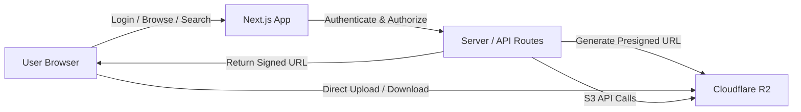
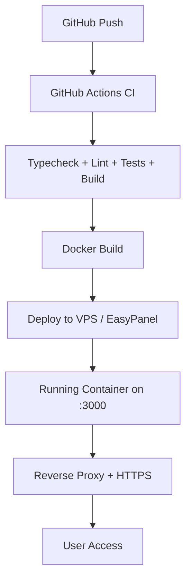

# Architecture

This document describes the high-level architecture of R2 Drive.

## Overview

R2 Drive is a self-hosted file manager for Cloudflare R2, built with Next.js
App Router and TypeScript. It uses a **direct-to-R2** architecture where the
browser transfers file bytes directly to/from Cloudflare R2 via presigned URLs,
while the Next.js server handles authentication, authorization, validation, and
signed URL generation.



## Components

### Browser (Client)

- **React 18** with Next.js App Router (client components where needed)
- **Tailwind CSS** for styling
- **lucide-react** for icons
- File explorer with list/grid views, breadcrumbs, search
- Upload engine with IndexedDB persistence for resumable uploads
- Preview modal for images, PDFs, audio, video, and sanitized Markdown

### Next.js Server

- **App Router** with Route Handlers (`app/api/`)
- **Server Components** for pages (dashboard, files, buckets, settings, recent)
- **Middleware-free** auth (session checks in API route handlers)

### Authentication Layer

| Module | Purpose |
|--------|---------|
| `lib/auth/password.ts` | bcrypt hashing and verification |
| `lib/auth/session.ts` | HMAC-SHA256 session cookie creation and verification |
| `lib/auth/guard.ts` | Session extraction from requests, API route guards |
| `lib/auth/rate-limit.ts` | Per-IP + username login rate limiting |
| `lib/csrf.ts` | Origin/Host validation for CSRF protection |

### R2 Service Layer

| Module | Purpose |
|--------|---------|
| `lib/r2/config.ts` | Environment variable reading and validation |
| `lib/r2/client.ts` | S3Client creation and caching |
| `lib/r2/buckets.ts` | Bucket listing, head, connection testing |
| `lib/r2/objects.ts` | Object listing, search, head metadata |
| `lib/r2/ops.ts` | File operations: create folder, copy, move, rename, delete |
| `lib/r2/presign.ts` | Presigned URL generation for uploads, downloads, previews |
| `lib/r2/multipart.ts` | Multipart upload lifecycle (create, part URLs, complete, abort) |
| `lib/r2/stats.ts` | Storage statistics and recent files |
| `lib/r2/health.ts` | Cached R2 health check |
| `lib/r2/connection-state.ts` | Connection status tracking |

### API Routes

24+ route handlers covering:

- **Auth**: login, logout, session check
- **Buckets**: list accessible buckets
- **Objects**: list, head, create folder, rename, copy, move, delete
- **Upload**: presigned PUT URL
- **Multipart**: create, part URLs, complete, abort
- **Download**: redirect to presigned download URL
- **Preview**: stream text content or redirect to presigned preview
- **Share**: generate short-lived share links
- **Search**: prefix-based object search
- **Recent**: recently modified files
- **Storage**: bucket storage statistics
- **Health**: unauthenticated liveness probe
- **R2 Status**: connection configuration status

### Upload Architecture

```
Small files (< 8 MiB):
  Browser → POST /api/upload/presign → Server returns presigned PUT URL
  Browser → PUT directly to R2 with presigned URL

Large files (>= 8 MiB):
  Browser → POST /api/multipart/create → Server creates multipart upload
  Browser → POST /api/multipart/part-url (per part) → Presigned part URLs
  Browser → PUT parts directly to R2 (3 concurrent parts, 2 files in parallel)
  Browser → POST /api/multipart/complete → Server finalizes upload

Resumable state:
  Upload progress persisted to IndexedDB
  On page reload, interrupted uploads resume automatically
```

### Data Flow

1. **Authentication**: User submits credentials → server verifies bcrypt hash →
   creates HMAC-signed session cookie
2. **Authorization**: Every API request (except health) checks session cookie →
   rejects unauthenticated requests with 401
3. **Object Operations**: Client sends request → server validates inputs →
   server calls R2 via AWS SDK → returns result to client
4. **File Transfer**: Server generates presigned URL → client transfers bytes
   directly to R2 → server never handles file content
5. **Multipart Upload**: Client orchestrates the entire upload process using
   presigned URLs obtained from the server

### Deployment



- **Docker**: Multi-stage build with non-root user
- **Healthcheck**: `/api/health` endpoint
- **Port**: 3000 (configurable)
- **Reverse Proxy**: Recommended (Caddy, nginx, Traefik) for HTTPS
